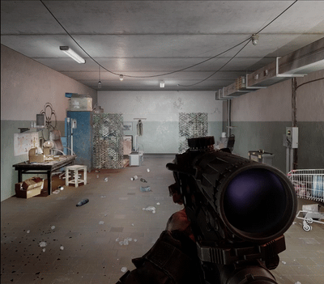
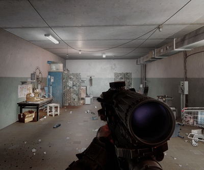

# Scope Handjob

**No more remote-control scopes.** In vanilla Tarkov the magnification, reticle or mode of a scope changes by itself, as if by remote control. With this mod your character's **left hand** reaches up to the scope and works it first: turns the zoom knob, throws the lever, presses the button or flips the magnifier. Then the hand goes back to the handguard.

A BepInEx client mod for **SPT 4.1.6**.

## Showcase

**Zoom key on a variable scope (EOTech Vudu):** one quick twist from 1x to 6x. The picture zooms in smoothly instead of jumping like vanilla.

**Mouse wheel (EOTech Vudu):** zoom in and out step by step. The left hand is on the knob for every turn.

**Thermal scope buttons (FLIR RS-32):** the hand presses the button on top of the scope to change zoom.

**Flip magnifier (EOTech HHS-1):** the hand flips the 3x magnifier up and down, both while aiming and from the hip.

## What it does

- **Mouse wheel zoom** on variable scopes: the hand grips the zoom knob and turns it with the magnification. If the knob has to turn further than a wrist can, the hand lets go, goes back and grips again.
- **Zoom / mode key** (default `T`):
  - Variable scopes: one quick twist from lowest to highest magnification, or back.
  - Lever scopes (ELCAN Specter DR, Valday PS-320): the hand throws the lever.
  - EOTech HHS-1: the hand flips the magnifier over, and the magnifier moves with the hand.
  - Sights with buttons (thermals, red dots, reticle or palette changes): the hand presses the button, or turns the knob on SUSAT and MARS.
- **Waits for the hand:** the change happens when the hand gets there, not before.
- **Fast presses:** the mode key counts at most 4 presses a second. Every press that counts gets its own hand movement.
- **Sights with nothing to switch:** pressing the mode key on a sight with only one mode does nothing at all, with no press animation and no gun wobble.
- **Canted sights** (on a 45° mount): while you aim through the canted sight, the mode key works on the canted sight only. While you are not aiming, it works on the main scope.
- **Gun shake:** the gun gives a small jolt when the hand leaves the handguard, works the scope, and comes back.
- **Stance Overhaul (Realism) support:** in Short Stock while not aiming, the gun is lowered first, the zoom changes, then Short Stock comes back. Stance Overhaul is optional.

Only your own character's hand moves. Other players and bots are not changed.

## Requirements

- SPT 4.1.6. BepInEx comes with SPT.
- Nothing else. Stance Overhaul, WTT-ContentBackport and WTT-Armory are optional.

## Install

1. Close the game.
2. Unzip `ScopeHandjob-1.0.0.zip` into your SPT folder, the one that has `EscapeFromTarkov.exe` in it.
3. You should now have `BepInEx/plugins/ScopeHandjob/ScopeHandjob.dll`.

To uninstall, delete the `BepInEx/plugins/ScopeHandjob` folder.

## Settings (F12)

| Section | Setting | What it does |
|---|---|---|
| 1. General | Enabled | Off = vanilla instant changes. |
| | Wait For Hand | On = the change waits for the hand. Off = instant change, and the hand only moves for looks. |
| | Ignore Mode Key When Nothing Changes | On = the mode key does nothing on one-mode sights. |
| 2. Timing | Reach / Return Time | How fast the hand goes to the scope and back. |
| | Hold After Zoom | How long the hand stays on the knob after the last scroll. |
| | Switch Time | How long one lever throw, button press or magnifier flip takes. |
| | Regrip Time | How long a regrip on the zoom knob takes. |
| | Fast Twist Time | How long the mode key's quick twist on a variable scope takes. |
| 3. Stance Overhaul | Short Stock: Lower To Change Zoom | On = lower the gun to change zoom in Short Stock. Off = no zoom change in Short Stock while not aiming. |
| 4. Gun Shake | Shake When Hand Moves (Mouse Wheel) / Shake When Hand Presses (Mode Key) / Shake Strength | Turn the jolts on or off and set how strong they are. |

## Supported scopes

Each scope has a hand animation made by hand in game. Scopes not on this list change the vanilla way, with no hand.

**Variable zoom or zoom modes:** Armasight Zeus-Pro 640 · Burris FullField TAC30 1-4x24 · DEON March-F 1-8x24 (WTT-ContentBackport) · ELCAN Specter DR 1x/4x (black and FDE) · EOTech HHS-1 (black and tan) · EOTech Vudu 1-6x24 · FLIR RS-32 · Hensoldt FF 4-16x56 · KMZ 1P59 3-10x · KMZ 1P69 3-10x · Leupold Mark 4 LR 6.5-20x50 · Leupold Mark 4 MR/T 2.5-8x36 (WTT-ContentBackport) · Leupold Mark 5HD 5-25x56 · March Tactical 3-24x42 · NcSTAR ADO P4 3-9x42 · Nightforce ATACR 7-35x56 · SIG Sauer ECHO1 · SIG Sauer TANGO6T 1-6x24 · Schmidt & Bender PM II 1-8x24, 3-20x50 and 5-25x56 · Valday PS-320 · Vortex Razor HD Gen.2 1-6x24 · Vortex Viper HS 2.5-10x (Eco Attachment Emporium)

**Reticle, brightness, laser or palette modes:** Axion Kobra EKP-1S-03, EKP-8-02 and EKP-8-18 · BAE SUSAT 4x32 (WTT-Armory) · BelOMO PK-06 · BelOMO PSO-1, PSO-1M2 and PSO-1M2-1 · Holosun HS401G5 · ITL MARS (WTT-Armory; its mode turns the IR laser on and off, which you can only see with night vision) · Leapers UTG · Monstrum Compact 2x32 · Monstrum Marksman 3x30 (WTT-ContentBackport) · Trijicon REAP-IR · VOMZ Pilad P1x42 · Walther MRS · Wilcox BOSS Xe

## Known limitations

- **Left hand only.**
- The animations were made with **WTT-ContentBackport** installed. That mod replaces the models of several scopes, for example the HHS-1, Vudu, Specter DR and some thermals. Without it, some of those scopes may have no hand, or the hand may not sit exactly on the part.
- A second sight stacked on top of a scope, such as the backup sight on a Specter DR or SUSAT, keeps the vanilla head movement and gets no hand.
- Not tested with Fika or other multiplayer mods.
- The gun-shake strengths are tuned by feel.

## Reporting a problem

Please open an issue and include:

- which scope and which gun,
- what you did (mouse wheel or mode key, aiming or not),
- your `BepInEx/LogOutput.log`.

## Disclaimer

This mod's code and the in-game posing tools were built with the help of AI. The hand animations themselves were made by hand: every pose was set and tuned in game by a person, using those AI-built tools.
